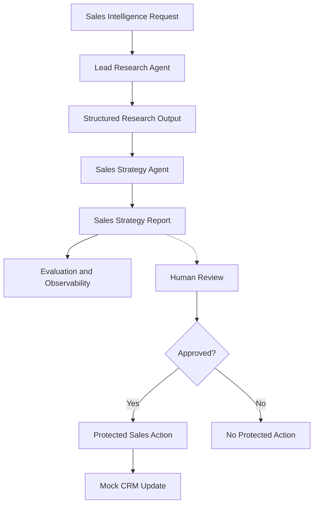

# Multi-Agent Sales Intelligence Platform

**An AI-powered B2B sales intelligence prototype built with CrewAI, DeepSeek, and Python.**

### Key Highlights

- **Multi-Agent Orchestration:** Two specialized CrewAI agents collaborate sequentially to transform company research into B2B sales strategies.
- **Evaluation & Quality Control:** Structured research validation, evaluation modules, and a golden dataset support output quality assessment.
- **Execution Observability:** Execution tracing, token usage tracking, and estimated model cost calculation improve transparency.
- **Human-in-the-Loop:** Approval workflows demonstrate how human oversight can govern sensitive sales actions.
- **Mock CRM Integration:** A JSON-based CRM prototype demonstrates approval-gated lead status updates without requiring a production CRM.

## 1. Project Overview

The Multi-Agent Sales Intelligence Platform is a prototype designed to help B2B sales teams automate company research, generate evidence-based sales strategies, and prepare actionable recommendations.

Traditional B2B sales research often involves manually collecting company information, identifying potential business needs, and translating research findings into outreach strategies. This process can be time-consuming, inconsistent, and difficult to verify.

This project explores how a multi-agent AI system can support these workflows while incorporating structured evaluation, execution observability, human approval, and simulated CRM integration.

### Product Goals

- **Improve research efficiency:** Automate the collection and organization of company intelligence.
- **Support evidence-based decisions:** Distinguish verified findings from assumptions and hypotheses.
- **Generate actionable strategies:** Translate research into potential sales opportunities and recommended next steps.
- **Maintain human oversight:** Require explicit human approval before protected sales actions.
- **Improve reliability and transparency:** Track execution behavior, evaluate outputs, and monitor token usage and costs.

### Current Implementation

The prototype includes two specialized AI agents:

1. **Lead Research Agent:** Researches target companies and produces structured company intelligence.
2. **Sales Strategy Agent:** Uses the research findings to develop sales recommendations and outreach strategies.

Additional modules support evaluation, tracing, human-in-the-loop approval, and a local JSON-based Mock CRM.

**Project Status:** Functional prototype. The CRM integration and end-to-end approval demonstration are simulated and are not connected to a production CRM system.

## 2. Multi-Agent Architecture

The platform uses a sequential multi-agent workflow built with CrewAI. Each agent is responsible for a distinct stage of the B2B sales intelligence process.

### Architecture Diagram



*Note: The research and strategy agents form the core CrewAI workflow. Human approval and Mock CRM updates are demonstrated through separate prototype modules rather than a fully automated end-to-end integration.*

### Agent Responsibilities

**1. Lead Research Agent**

Responsible for collecting and organizing information about a target company, including its business model, market positioning, recent developments, potential business needs, and sales opportunities.

The agent distinguishes verified findings from hypotheses to improve transparency and reduce unsupported conclusions.

**2. Sales Strategy Agent**

Uses the research findings to develop an actionable B2B sales strategy, including potential customer needs, value propositions, stakeholder considerations, outreach recommendations, and suggested next steps.

### Design Rationale

The system separates research from strategy generation to establish clear responsibilities, enable stage-specific evaluation, and make outputs easier to inspect.

A sequential workflow ensures that the Sales Strategy Agent can use the research produced by the Lead Research Agent.

### Supporting Capabilities

- **Evaluation:** Structured output validation, Golden Dataset evaluation, and LLM-as-a-Judge experiments.
- **Observability:** Execution traces, task events, token tracking, and cost estimation.
- **Human-in-the-Loop:** Approval records and authorization checks before protected sales actions.
- **Mock CRM:** Local JSON-based lead storage and approval-gated updates.

## 3. Key Features

The platform combines multi-agent collaboration with evaluation, observability, human oversight, and simulated business system integration.

| Capability | Description | Implementation Status |
|---|---|---|
| Multi-Agent Orchestration | Two specialized CrewAI agents collaborate sequentially on company research and sales strategy generation. | Implemented |
| Structured Research | Generates company intelligence while distinguishing verified findings from hypotheses. | Implemented |
| Sales Strategy Generation | Transforms research findings into sales recommendations, value propositions, and suggested next steps. | Implemented |
| Output Evaluation | Supports structured validation, Golden Dataset evaluation, and LLM-as-a-Judge experiments. | Prototype |
| Execution Observability | Records execution traces, task events, token usage, and estimated costs. | Implemented |
| Human-in-the-Loop Approval | Supports approval records, review decisions, and authorization checks before protected actions. | Implemented |
| Mock CRM Integration | Stores leads in local JSON files and supports approval-gated lead updates. | Prototype |
| Automated Testing | Includes 19 passing automated tests covering core behaviors and selected reliability scenarios. | Verified |

### Product Design Principles

**Evidence Before Recommendations**

The system separates company research from sales strategy generation, encouraging recommendations to be grounded in research findings rather than unsupported assumptions.

**Human Oversight for Business Actions**

AI-generated recommendations do not automatically authorize protected sales actions. Human approval is required before executing the approval-gated CRM update workflow.

**Observable and Testable AI Workflows**

Execution tracing, token monitoring, evaluation modules, and automated tests help developers inspect system behavior and identify potential failures.

**Modular Integration**

Research, strategy generation, evaluation, approval management, and CRM operations are implemented as separate modules to support future extension and integration.

## 4. End-to-End Workflow

The intended product workflow consists of six stages.

### Stage 1 — Sales Intelligence Request

A user provides a target company, industry, and solution information.

### Stage 2 — Company Research

The Lead Research Agent gathers and organizes company information, including relevant business developments, potential needs, and opportunities.

### Stage 3 — Sales Strategy Generation

The Sales Strategy Agent uses the research output to produce a sales strategy and recommended next steps.

### Stage 4 — Evaluation and Observability

Supporting modules enable output evaluation, execution tracing, token tracking, and cost estimation.

### Stage 5 — Human Review

A human reviewer can approve, reject, or request revisions to a proposed sales action.

The approval manager records the decision and prevents unauthorized or duplicate review submissions in the tested scenarios.

### Stage 6 — Mock CRM Update

After a valid approval, the prototype can update a lead in its local JSON-based Mock CRM.

For example:

- Initial lead status: `NEW`
- Human review decision: `APPROVED`
- Updated lead status: `QUALIFIED`
- Recommended next action: `Schedule an introductory meeting.`

### Integration Boundary

The core CrewAI research and strategy workflow is implemented separately from the human approval and Mock CRM demonstration.

The current demo simulates completion of an Agent run before creating an approval record and a CRM lead. It does not yet provide a fully automated integration from a real Agent report to human review and CRM synchronization.

The Mock CRM is a local prototype, not a production Salesforce or HubSpot integration.


## 5. Installation & Quick Start

### Prerequisites

Before running the project, make sure you have:

- Python >=3.10, <3.14 (developed and tested with Python 3.11.9)
- [uv](https://docs.astral.sh/uv/) for Python dependency management
- A DeepSeek API key
- A Serper API key for web research

The project uses CrewAI for multi-agent orchestration and DeepSeek Flash (`deepseek/deepseek-flash`) for both the Lead Research Agent and the Sales Strategy Agent.

### Step 1 — Clone the Repository

```bash
git clone https://github.com/YOUR_USERNAME/multi_agent_sales_intelligence.git
cd multi_agent_sales_intelligence
```

Replace `YOUR_USERNAME` with the actual GitHub username after publishing the repository.

### Step 2 — Install Dependencies

Install the project's dependencies using uv:

```bash
uv sync
```

This creates a local Python environment and installs the dependencies defined in `pyproject.toml` and `uv.lock`.

### Step 3 — Configure Environment Variables

### Step 3 — Configure Environment Variables

Copy the example environment file to create your local `.env` file:

```powershell
Copy-Item .env.example .env
```

Open `.env` and replace the placeholder values with your own API keys:

```dotenv
DEEPSEEK_API_KEY=your_deepseek_api_key
SERPER_API_KEY=your_serper_api_key
```

- `DEEPSEEK_API_KEY`: Required for DeepSeek model access.
- `SERPER_API_KEY`: Required for web search using SerperDevTool.

**Security:** Never commit your `.env` file or real API keys to GitHub. The `.env.example` file contains placeholders only and is safe to share.

### Step 4 — Run the Multi-Agent Workflow

Run the CrewAI workflow from the project root:

```bash
uv run crewai run
```

The workflow executes the Lead Research Agent followed by the Sales Strategy Agent.

The configured agents generate research findings and sales strategy recommendations for the target company.

**Important:** Running the live workflow may call DeepSeek and Serper APIs and incur usage costs.

### Step 5 — Run Automated Tests

Run the project's automated tests:

```bash
uv run pytest tests/ -v
```

Latest verified local test result:

```text
19 passed, 7 warnings in 7.81s
```

The tested scenarios include approval authorization, duplicate review protection, CRM status validation, execution tracing, and token tracking.

### Step 6 — Run the Mock CRM Demo

The project also provides a simulated approval and CRM workflow.

First, prepare a demo review and lead:

```bash
uv run python -c "from multi_agent_sales_intelligence.demo_workflow import prepare_demo_workflow; prepare_demo_workflow('demo-readme-001', 'Demo Company', 'lead-readme-001')"
```

This creates a pending review and a new Mock CRM lead.

Next, approve the demo:

```bash
uv run python -c "from multi_agent_sales_intelligence.approval_manager import submit_review; submit_review('demo-readme-001', 'Sales Manager', 'APPROVED', 'Approved for demo.')"
```

Then update the CRM lead:

```bash
uv run python -c "from multi_agent_sales_intelligence.mock_crm import update_lead_after_approval; update_lead_after_approval('lead-readme-001', 'demo-readme-001', 'QUALIFIED', 'Schedule an introductory meeting.')"
```

Finally, verify the saved lead:

```bash
uv run python -c "from multi_agent_sales_intelligence.mock_crm import get_lead; print(get_lead('lead-readme-001').model_dump_json(indent=2))"
```

Expected lead status:

```json
{
  "lead_id": "lead-readme-001",
  "company_name": "Demo Company",
  "run_id": "demo-readme-001",
  "status": "QUALIFIED",
  "next_action": "Schedule an introductory meeting."
}
```

The saved record also includes an `updated_at` timestamp.

This demo does not require running the live CrewAI agents or calling DeepSeek.

**Note:** The demo uses persistent local JSON files. Reusing the same Run ID may be rejected because duplicate approval creation is prohibited. Use a new Run ID and Lead ID when repeating the demo.

## 6. Project Structure

The project follows a modular architecture that separates multi-agent orchestration, evaluation, observability, human approval, and CRM operations.

```text
multi_agent_sales_intelligence/
│
├── src/
│   └── multi_agent_sales_intelligence/
│       ├── config/
│       │   ├── agents.yaml
│       │   ├── tasks.yaml
│       │   └── judge_rubric.yaml
│       │
│       ├── tools/
│       │   └── custom_tool.py
│       │
│       ├── main.py
│       ├── crew.py
│       ├── models.py
│       │
│       ├── evaluation.py
│       ├── golden_runner.py
│       ├── judge.py
│       │
│       ├── tracing.py
│       ├── cost_calculator.py
│       │
│       ├── approval_manager.py
│       ├── sales_action.py
│       ├── mock_crm.py
│       └── demo_workflow.py
│
├── tests/
│   ├── golden_dataset.json
│   └── test_*.py
│
├── knowledge/
│   └── user_preference.txt
│
├── pyproject.toml
├── uv.lock
├── model_pricing.json
├── .gitignore
└── README.md
```

*Note: Local runtime files, including approval records, CRM data, execution traces, and generated reports, are excluded from this repository structure.*

### Core Modules

| Module | Responsibility |
|---|---|
| `main.py` | Entry point for executing the CrewAI workflow |
| `crew.py` | Defines agents, tasks, and sequential orchestration |
| `config/agents.yaml` | Configures agent roles, goals, and backstories |
| `config/tasks.yaml` | Defines research and sales strategy tasks |
| `models.py` | Defines structured data models |
| `evaluation.py` | Implements research output evaluation |
| `golden_runner.py` | Runs evaluations against a Golden Dataset |
| `judge.py` | Supports LLM-as-a-Judge evaluation |
| `tracing.py` | Records execution and task-level observability data |
| `cost_calculator.py` | Estimates model usage costs |
| `approval_manager.py` | Manages human approval records and decisions |
| `sales_action.py` | Implements approval-controlled sales actions |
| `mock_crm.py` | Provides local JSON-based lead storage and updates |
| `demo_workflow.py` | Demonstrates the approval and Mock CRM workflow |
| `tests/` | Contains automated tests and evaluation fixtures |

## 7. Technology Stack

| Category | Technology | Purpose |
|---|---|---|
| Programming Language | Python 3.11 | Core application development |
| Agent Framework | CrewAI | Multi-agent orchestration and task execution |
| Large Language Model | DeepSeek | Research and strategy generation |
| Web Search | Serper API | External company research |
| Data Validation | Pydantic | Structured data modeling and validation |
| Dependency Management | uv | Environment and package management |
| Testing | pytest | Automated testing and reliability checks |
| Configuration | YAML | Agent, task, and evaluation configuration |
| Local Storage | JSON | Mock CRM records, approval data, and execution traces |
| Version Control | Git / GitHub | Source management and portfolio presentation |

### Why CrewAI?

CrewAI was selected to demonstrate a role-based multi-agent architecture with clear responsibilities and sequential task execution.

The framework makes it possible to separate company research from sales strategy generation while maintaining a coordinated workflow.

### Why Human-in-the-Loop?

Sales intelligence recommendations may influence real customer interactions and CRM records.

Human approval provides a control point between AI-generated recommendations and business actions, allowing a reviewer to inspect proposed actions before execution.

### Why Evaluation and Observability?

An AI Agent system should not be evaluated only by whether it produces an answer.

The prototype includes evaluation and observability capabilities to explore additional dimensions of system quality, including:

- Research output structure and evidence quality
- Agent execution and task-level behavior
- Token consumption and estimated costs
- Approval authorization and state transitions
- Reliability of selected business workflow operations

These capabilities help identify potential failures and support more systematic product iteration.

## 8. Demo Results

### Automated Testing

The prototype was validated using pytest, with 19 tests passing in the recorded local test run. These tests cover selected approval, Mock CRM, tracing, token usage, and cost calculation behaviors.

### Human-in-the-Loop & Mock CRM Demo

A local demonstration verified the following workflow:

1. Create a pending human review and a Mock CRM lead.
2. Approve the review through an explicit human decision.
3. Update the CRM lead status from `NEW` to `QUALIFIED`.
4. Retrieve the persisted CRM record and verify the updated status and next action.

**Demo Result:** The approval-gated CRM update completed successfully.

**Scope:** This demonstration uses local Python modules and JSON-based storage. It does not execute the live CrewAI agents or connect to a production CRM system.

## 9. Limitations & Future Roadmap

### Current Limitations

- **Separate workflow modules:** The live CrewAI research and strategy workflow is not yet automatically connected to the human approval and Mock CRM demonstration.
- **Mock CRM only:** CRM records are stored in local JSON files rather than a production CRM system.
- **Limited approval enforcement:** Approval is required for the protected CRM update operation, but not every direct CRM write operation is approval-gated.
- **Prototype-level persistence:** Local JSON storage does not provide production-grade transaction handling, concurrent access control, or database reliability.
- **Limited evaluation coverage:** The current evaluation framework and golden dataset provide an initial foundation but require broader test cases and systematic benchmarking.

### Future Roadmap

1. **End-to-End Workflow Integration:** Connect actual Agent outputs to human review and approved CRM actions.
2. **Production CRM Integration:** Integrate with a CRM platform through authenticated APIs and controlled permissions.
3. **Stronger Human-in-the-Loop Controls:** Enforce approval policies consistently across sensitive actions and maintain auditable review histories.
4. **Evaluation Expansion:** Introduce larger golden datasets, regression testing, and measurable quality benchmarks.
5. **Production Readiness:** Improve persistence, error handling, retry strategies, security, and operational monitoring.

### Product Vision

The long-term goal is to evolve the prototype into a reliable, evidence-driven sales intelligence system that combines multi-agent collaboration, measurable output quality, operational transparency, and human oversight.